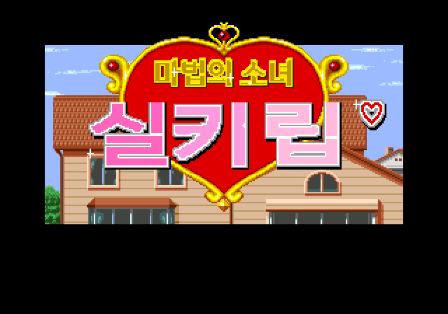
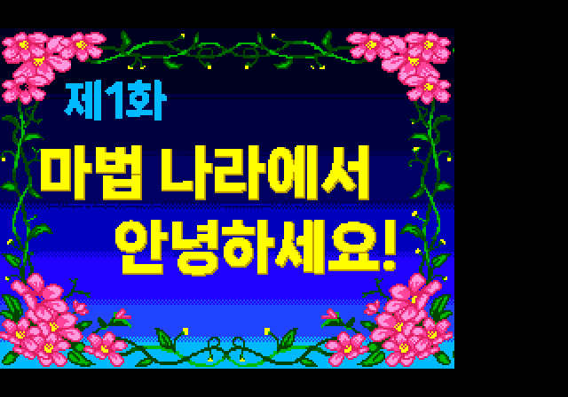
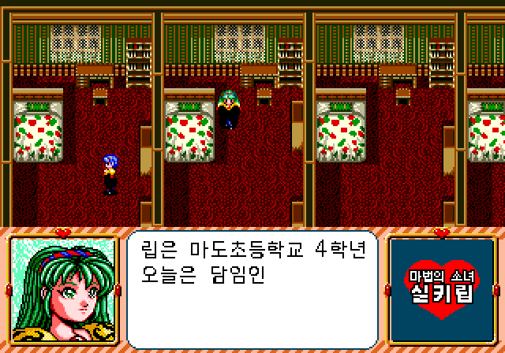
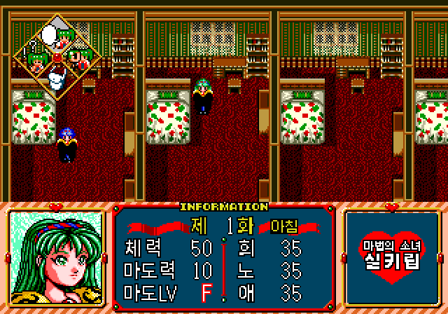
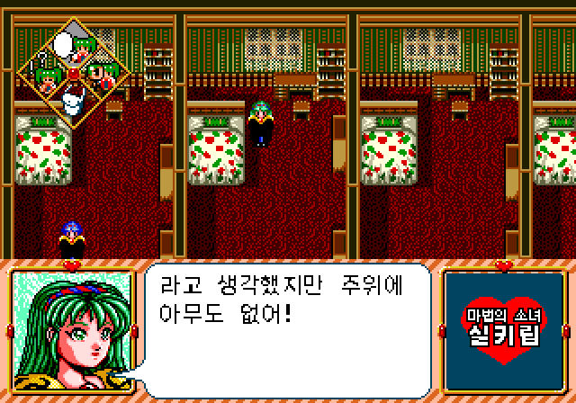

# 마법의 소녀 실키립 — 메가 CD 한글패치

일본판 **魔法の少女シルキーリップ (Mahou no Shoujo - Silky Lip)**(메가 CD)의 비공식 한글패치 **v1.0.0 (2026-11-04)** 입니다. 외부 기계 번역 없이 직접 번역했습니다.

[정식 패치 다운로드](https://github.com/snake759494/mahou-no-shoujo-silky-lip-segacd-korean-patch/releases/latest) · [빌드](docs/BUILD.md) · [기술 설명](docs/TECHNICAL.md) · [검증 범위](docs/VALIDATION.md) · [권리 안내](RIGHTS.md)

## 적용 방법

1. 직접 준비한 원본 CHD의 SHA-256이 아래 `source`와 일치하는지 확인합니다.
2. 릴리즈에서 **Mahou_no_Shoujo_Silky_Lip_SCD_KR.xdelta** 하나를 받습니다.
3. xdelta UI 또는 아래 명령으로 원본 CHD에 적용합니다.
4. 결과 CHD의 SHA-256을 확인한 뒤 새로 부팅합니다. 원본에서 만든 세이브 스테이트보다 콜드 부팅을 권장합니다.

```powershell
.\xdelta.exe -D -d -s 'Mahou no Shoujo - Silky Lip (Japan).chd' 'Mahou_no_Shoujo_Silky_Lip_SCD_KR.xdelta' 'Mahou no Shoujo - Silky Lip (Japan) (Korean).chd'
Get-FileHash -Algorithm SHA256 'Mahou no Shoujo - Silky Lip (Japan) (Korean).chd'
```

원본·패치·결과 해시를 한 번에 확인하려면 저장소의 `tools/apply_release.py`를 사용할 수 있습니다.

| 구분 | 바이트 | SHA-256 |
| --- | ---: | --- |
| source | 192,038,200 | `437076f35cc80bbae2233e83671dcdb41a68a314c9eada8335886e3857ab5e48` |
| output | 188,077,791 | `ac7124c6fc3fd2441b6dcefba9f75cbb9a56db5a7d27c795701fda2e1667d0bf` |
| patch | 181,702,936 | `bb3f1a6c7286f11883e42f95444cbf193bca062ed7a179eb4f9821ac69fd7d6b` |

패치는 CHD 파일 기준입니다. CHD는 압축 파일이라 패치 크기가 큽니다. xdelta는 **`-0 -S none -D`**로 빠르게 생성했습니다. 릴리즈 첨부는 xdelta 하나이며 디스크 이미지·폰트·외부 실행파일·저장 파일은 포함하지 않습니다.

## 한글화 내용

- 본편 대사·나레이션·선택지·메뉴 등 **3,571줄** 직접 번역(학교·집·마을 이벤트, 상태·체크·기분전환 메뉴 포함).
- 제1화~제11화 **장 제목 카드** 그림.
- 게임 화면 **정보창(INFORMATION)** 라벨: 체력·마도력·마도LV·회·노·애, 화·아침 등.
- **타이틀 화면**: 魔法の少女 → 마법의 소녀, シルキーリップ → 실키립, 시작 안내 → 스타트 버튼을 눌러줘♥. 영어 저작권 표기는 그대로 두었습니다.
- 게임 화면 우측 **하트 로고**(게임 아이콘): 마법의 소녀 / 실키립.
- 디스크 헤더의 국내용 게임 이름: 마법의 소녀 실키립.
- 대사는 원본 한자 글꼴 자리에 넣은 **나눔스퀘어 네오**, 작은 글자는 **갈무리**, 큰 그림 글자는 나눔스퀘어 네오 Bold·ExtraBold·Heavy를 원래 색 번호로 그렸습니다.

 
 


## 알려진 사항

- 디스크 헤더 게임 이름은 원래 Shift-JIS 자리라 UTF-8 한글로 넣었습니다. 헤더를 Shift-JIS로 읽는 프로그램에서는 깨져 보일 수 있습니다(게임 실행에는 영향 없음).
- 한글은 KS X 1001 완성형 2,350자 범위만 쓸 수 있어 번역문도 그 범위로 맞췄습니다.

## 검증 범위

헤드리스 ClownMDEmu(libretro)로 최종 해시의 디스크를 콜드 부팅해 타이틀 화면·제1화 장 제목·도입부 대사·정보창·하트 로고를 확인했고, 직접 플레이하며 찾은 미번역 부분을 추가 패치했습니다. 빌드는 번역 누락·길이 초과·오류 0이며, xdelta를 원본에 적용한 결과가 릴리즈 CHD와 같음을 확인했습니다. 검증용 에뮬레이터는 종료했습니다.

**전편 실제 플레이, 헤더 이름의 실제 표시, 실기 검증은 미실시입니다.** 자세한 내용은 [검증 문서](docs/VALIDATION.md)를 확인하세요.

## 공개 자료

`translation/`에 직접 번역한 한국어 문장(`k*.txt`, 번호는 원문 목록 순서)을, `tools/`에 빌드 도구(파이썬)를 공개합니다. 일본어 원문은 포함하지 않으며 빌드 시 사용자 디스크에서 추출합니다. 재빌드에는 사용자가 준비한 원본 디스크와 글꼴이 필요합니다. 이 저장소는 원작이나 글꼴의 권리를 부여하지 않습니다.

문제 제보에는 원본·결과 해시, 발생 위치, 재현 순서와 화면 캡처를 첨부해 주세요. 디스크 이미지와 저장 파일은 공개 이슈에 올리지 마세요.
